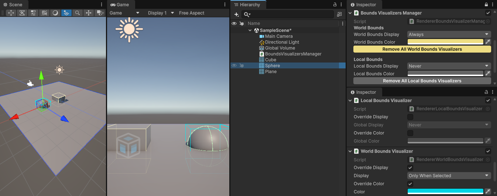

# Renderer Bounds Visualizer for Unity

A set of Unity scripts for visualizing the Renderer bounds.

Unexpectedly disappearing objects are often caused by inaccurate Renderer bounds, which Unity relies on for frustum culling. Use these scripts to quickly inspect your object's bounds and identify culling issues in seconds.



- Visualizers are theoretically compatible with any components derived from `Renderer` (tested with `MeshRenderer` and `SkinnedMeshRenderer`).
- You can view both local and world-space bounds.
- Set when bounds are displayed (`Always`, `Never`, or `Only When Selected`) and customize the colors; either via the optional centralized Manager, or using the per-Visualizer overrides.
- As it uses Gizmos, you can view the bounds in both Scene View and Game View.
- You can mass-remove the visualizers from the scene.
- Any display logic is stripped out from builds even if visualizers are not removed.

*Note that these scripts display the Renderer bounds. Renderer bounds are not necessarily representing the bounds stored in the mesh.*

## Installation

1. Press the green button with the `<> Code`label above.
2. From there, copy the HTTPS URL of this repository (the one that you would use for cloning the repo). 
3. In Unity, open the Package Manager.
4. Click the `+` button and select `Install package from git URL...`
5. Paste the URL and install the package.


## Known issues and limitations

- The manager class is designed to be a singleton, but ensuring a single `MonoBehaviour` script instance in both play mode and edit mode is a bit tricky, so I implemented it the easy way via `OnEnable`/`OnDisable`. These event methods might not be called in all cases (e.g., when the game object is inactive). So it is best to avoid adding multiple instances of the manager to the scene.


## AI use disclosure

- Some of the code was generated with AI and refactored afterwards.
- AI autocompletion was enabled in the IDE.
- Few parts of this README were improved using AI.


## License

[MIT](LICENSE.md)

```
MIT License

Copyright (c) 2026 Vladimir Klubkov

Permission is hereby granted, free of charge, to any person obtaining a copy
of this software and associated documentation files (the "Software"), to deal
in the Software without restriction, including without limitation the rights
to use, copy, modify, merge, publish, distribute, sublicense, and/or sell
copies of the Software, and to permit persons to whom the Software is
furnished to do so, subject to the following conditions:

The above copyright notice and this permission notice shall be included in all
copies or substantial portions of the Software.

THE SOFTWARE IS PROVIDED "AS IS", WITHOUT WARRANTY OF ANY KIND, EXPRESS OR
IMPLIED, INCLUDING BUT NOT LIMITED TO THE WARRANTIES OF MERCHANTABILITY,
FITNESS FOR A PARTICULAR PURPOSE AND NONINFRINGEMENT. IN NO EVENT SHALL THE
AUTHORS OR COPYRIGHT HOLDERS BE LIABLE FOR ANY CLAIM, DAMAGES OR OTHER
LIABILITY, WHETHER IN AN ACTION OF CONTRACT, TORT OR OTHERWISE, ARISING FROM,
OUT OF OR IN CONNECTION WITH THE SOFTWARE OR THE USE OR OTHER DEALINGS IN THE
SOFTWARE.
```